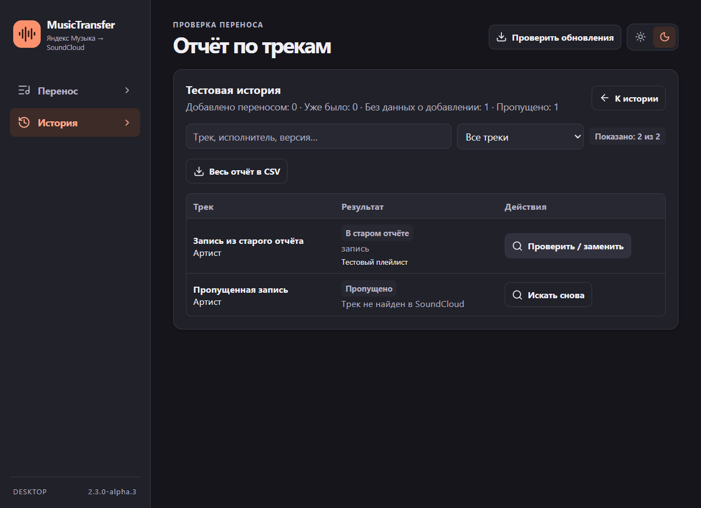

<div align="center">
  

  <h1>MusicTransfer</h1>

  <p><strong>Перенос плейлистов из Яндекс Музыки в SoundCloud</strong></p>

  <p>Windows x64 · Rust · Tauri 3 Alpha · React</p>

  <p>
    <a href="https://github.com/BYxarek/MusicTransfer/releases">Скачать для Windows</a> ·
    <a href="#как-перенести-плейлист">Как пользоваться</a> ·
    <a href="#сборка-из-исходников">Сборка из исходников</a>
  </p>
</div>

MusicTransfer считывает треки из плейлиста Яндекс Музыки, подбирает записи на SoundCloud и добавляет их в плейлист. Можно доверить подбор приложению или сверить найденные версии вручную. Отчёт сохраняет результат по каждому треку, поэтому прерванный перенос можно продолжить позже.



## Установка

1. Скачайте файл **x64-setup.exe** из [релизов GitHub](https://github.com/BYxarek/MusicTransfer/releases) и запустите его. В релизе также есть переносимый EXE.
2. Для работы нужны Google Chrome и Microsoft Edge WebView2. Установщик проверяет наличие WebView2.
3. Откройте **MusicTransfer Alpha**. Сборка проверяет альфа-канал при запуске. Ручная проверка доступна по кнопке **Проверить обновления**.

## Как перенести плейлист

1. Вставьте ссылку на плейлист Яндекс Музыки, нажмите **Открыть плейлист** и подтвердите список треков.
2. Войдите в SoundCloud в открывшемся окне Chrome. Когда появится аватар, нажмите **Начать поиск**. При проблемах с входом используйте **Войти в обычном Chrome**. Проверку с ползунком пройдите в браузере вручную.
3. Создайте закрытый плейлист или выберите свой существующий. Следите за прогрессом в приложении. При необходимости подтвердите предложенную запись или уточните запрос.
4. Откройте **История → Отчёт по трекам**, чтобы проверить добавленные и пропущенные треки, открыть плейлисты или выгрузить CSV.

| Возможность | Как работает |
| --- | --- |
| Автоматический подбор | Настройки учитывают точные и похожие совпадения. Полностью автоматический режим выбирает подходящую запись из первых трёх результатов, когда обычно нужен ручной выбор. При отсутствии совпадений трек пропускается. |
| Ручной выбор | Можно уточнить запрос, открыть оригинал и найденные записи, сравнить версии и длительность. Стрелки меняют выбор, Enter подтверждает его, Ctrl + → откладывает трек. |
| Большие плейлисты | После 500 треков создаётся следующая закрытая часть. Проверка дубликатов охватывает связанные части. |
| Восстановление | После сбоя приложение сверяет неподтверждённое добавление перед повтором. Ошибки поиска учитываются отдельно от отсутствующих треков. |
| История и отчёты | Можно повторить поиск пропущенных, проверить или заменить добавленную запись, выгрузить весь отчёт или текущую выборку в CSV. |
| Работа в фоне | Доступны звук и уведомления Windows. Приложение запоминает тему и положение окна. |

## Где хранятся данные

| Данные | Папка |
| --- | --- |
| История и отчёты | `%LOCALAPPDATA%\MusicTransfer\Reports` |
| Журнал действий | `%LOCALAPPDATA%\MusicTransfer\Logs` |
| Диагностика | `%LOCALAPPDATA%\MusicTransfer\Diagnostics` |
| Профиль Chrome для переноса | `%USERPROFILE%\.yandex-soundcloud-transfer` |

Авторизация хранится в выделенном профиле Chrome. GitHub используется для исходников, установщиков и проверки обновлений. Работа с плейлистами зависит от интерфейсов Яндекс Музыки и SoundCloud, поэтому изменения на сайтах могут потребовать обновления приложения.

Если отчёты старой версии лежат рядом с её EXE, их можно скопировать в папку `Reports`. Альфа-сборка устанавливается отдельно от MusicTransfer 2.2.1. Перед переносом закройте другое окно приложения, если оно использует тот же профиль Chrome.

Чтобы удалить сохранённую запись, выберите её в **Истории**, нажмите **Удалить из истории** и подтвердите. Удаляется локальный отчёт вместе с возможностью продолжить этот перенос. Плейлисты на музыкальных сервисах сохраняются.

## Сборка из исходников

На Windows понадобятся Node.js, Rust MSVC 1.95 или новее и Visual Studio C++ Build Tools. Тест браузера использует установленный Chrome с временным профилем. [Требования Tauri](https://v3.tauri.app/start/prerequisites/)

```powershell
git clone https://github.com/BYxarek/MusicTransfer.git
cd MusicTransfer
npm ci
npm run tauri -- dev
```

Для сборки установщика и запуска тестов выполните отдельные команды.

```powershell
npm run tauri -- build --bundles nsis
cargo test --manifest-path src-tauri/Cargo.toml --locked -- --include-ignored
```

## Альфа-канал

Установщики и заметки к версиям находятся в [GitHub Releases](https://github.com/BYxarek/MusicTransfer/releases), а текущий манифест — в [ветке updates](https://github.com/BYxarek/MusicTransfer/blob/updates/latest.json). Перед установкой Tauri проверяет подпись файла и версию, с которой он подписан. Сборки до `2.3.0-alpha.3` можно обновить вручную с помощью нового установщика. [Документация Tauri Updater](https://v3.tauri.app/plugin/updater/)

Звук уведомления использует Ding.wav от Robin Lamb (CC0). [Источник звука](https://opengameart.org/content/ui-sound-effects-button-clicks-user-feedback-notifications)
